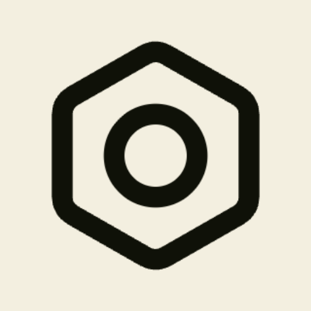

# MonoBrowser



Minimal browser built with **PyQt6** + **Qt Quick/QML** + **QtWebEngine**.

> macOS only — Windows and Linux are neither tested nor supported.

## Requirements

- macOS on Apple Silicon
- For development: `uv` and a display

## Development

```bash
uv run -m monobrowser.main
```

## Dependencies

- `src/assets/filters/easylist.txt` and `src/assets/filters/easyprivacy.txt` — [EasyList](https://easylist.to/) and EasyPrivacy (GPLv3-or-later / CC BY-SA 3.0-or-later, attribution to the EasyList authors). Used for native ad blocking through a QtWebEngine URL request interceptor: `||domain^` rules and `@@` exceptions are supported, along with `$third-party` and `$domain=` options; cosmetic rules are not evaluated. Settings → Ad blocking toggles the network blocker and an optional CSS-based hiding of ad containers. The bundled lists are a static snapshot; to refresh them:

  ```bash
  curl -fsSL https://easylist.to/easylist/easylist.txt -o src/assets/filters/easylist.txt
  curl -fsSL https://easylist.to/easylist/easyprivacy.txt -o src/assets/filters/easyprivacy.txt
  ```

## Tests

```bash
uv run ruff check . && uv run ruff format --check . && uv run mypy src tests && uv run pytest -q
```
## Build (standalone .app)

```bash
./build.sh
```

Output: `dist/MonoBrowser.app`

```bash
open dist/MonoBrowser.app
```
